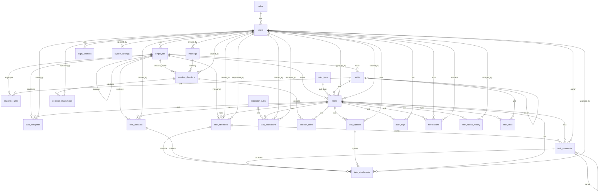

# مخطط قاعدة البيانات (PostgreSQL)

مولّد آليًا من نماذج Django (`apps/*/models.py`). يُنشأ المخطط فعليًا عبر `python manage.py migrate`.

## مخطط العلاقات

## الجداول

### `permissions` — صلاحية

| العمود | النوع | NULL | ملاحظات |
|---|---|---|---|
| `id` | integer | لا | PK |
| `code` | varchar(60) | لا | UNIQUE |
| `name` | varchar(120) | لا |  |
| `group` | varchar(60) | لا |  |

### `roles` — دور

| العمود | النوع | NULL | ملاحظات |
|---|---|---|---|
| `id` | integer | لا | PK |
| `code` | varchar(40) | لا | UNIQUE · قيم: admin، executive_director، ed_assistant، unit_head، employee، viewer |
| `name` | varchar(80) | لا |  |
| `description` | text | لا |  |
| `is_system` | bool | لا |  |
| (M2M) `permissions` | ← role_permissions | | → permissions |

### `users` — مستخدم

| العمود | النوع | NULL | ملاحظات |
|---|---|---|---|
| `id` | integer | لا | PK |
| `password` | varchar(128) | لا |  |
| `last_login` | datetime | نعم |  |
| `is_superuser` | bool | لا |  |
| `email` | varchar(254) | لا | UNIQUE |
| `phone` | varchar(20) | نعم | UNIQUE |
| `full_name` | varchar(150) | لا |  |
| `role_id` | bigint | نعم | FK → roles (PROTECT) |
| `is_active` | bool | لا |  |
| `is_staff` | bool | لا |  |
| `date_joined` | datetime | لا |  |
| `failed_login_count` | smallint unsigned | لا |  |
| `locked_until` | datetime | نعم |  |
| `otp_enabled` | bool | لا |  |
| `must_change_password` | bool | لا |  |
| (M2M) `groups` | ← users_groups | | → auth_group |
| (M2M) `user_permissions` | ← users_user_permissions | | → auth_permission |

- فهرس `users_is_acti_847b48_idx`: (is_active)

### `login_attempts` — login attempt

| العمود | النوع | NULL | ملاحظات |
|---|---|---|---|
| `id` | integer | لا | PK |
| `identifier` | varchar(190) | لا |  |
| `user_id` | bigint | نعم | FK → users (SET_NULL) |
| `ip_address` | char(39) | نعم |  |
| `user_agent` | varchar(300) | لا |  |
| `success` | bool | لا |  |
| `reason` | varchar(120) | لا |  |
| `created_at` | datetime | لا |  |

- فهرس `login_attem_ip_addr_f68fb5_idx`: (ip_address, created_at)
- فهرس `login_attem_identif_2d20fd_idx`: (identifier, created_at)

### `units` — وحدة تنظيمية

| العمود | النوع | NULL | ملاحظات |
|---|---|---|---|
| `id` | integer | لا | PK |
| `name` | varchar(150) | لا | UNIQUE |
| `code` | varchar(30) | نعم | UNIQUE |
| `description` | text | لا |  |
| `head_id` | bigint | نعم | FK → employees (SET_NULL) |
| `parent_id` | bigint | نعم | FK → units (SET_NULL) |
| `is_active` | bool | لا |  |
| `established_on` | date | لا |  |
| `sort_order` | smallint unsigned | لا |  |
| `created_at` | datetime | لا |  |

### `employees` — موظف

| العمود | النوع | NULL | ملاحظات |
|---|---|---|---|
| `id` | integer | لا | PK |
| `user_id` | bigint | نعم | UNIQUE · FK → users (SET_NULL) |
| `employee_no` | varchar(30) | لا | UNIQUE |
| `full_name` | varchar(150) | لا |  |
| `job_title` | varchar(150) | لا |  |
| `manager_id` | bigint | نعم | FK → employees (SET_NULL) |
| `join_date` | date | نعم |  |
| `photo` | varchar(100) | نعم |  |
| `status` | varchar(20) | لا | قيم: active، leave، inactive |
| `created_at` | datetime | لا |  |
| (M2M) `units` | ← employee_units | | → units |

- فهرس `employees_status_0192ac_idx`: (status)

### `employee_units` — employee unit

| العمود | النوع | NULL | ملاحظات |
|---|---|---|---|
| `id` | integer | لا | PK |
| `employee_id` | bigint | لا | FK → employees (CASCADE) |
| `unit_id` | bigint | لا | FK → units (CASCADE) |
| `is_primary` | bool | لا |  |

- قيد `uniq_employee_unit`: employee, unit

### `task_types` — task type

| العمود | النوع | NULL | ملاحظات |
|---|---|---|---|
| `id` | integer | لا | PK |
| `name` | varchar(100) | لا | UNIQUE |
| `description` | varchar(250) | لا |  |
| `is_active` | bool | لا |  |

### `tasks` — task

| العمود | النوع | NULL | ملاحظات |
|---|---|---|---|
| `id` | integer | لا | PK |
| `number` | varchar(20) | نعم | UNIQUE |
| `title` | varchar(250) | لا |  |
| `description` | text | لا |  |
| `source` | varchar(30) | لا | قيم: meeting_decision، ed_assignment، operational_plan، incoming_letter، outgoing_letter، internal_procedure، project، unit_request، standalone، other |
| `source_reference` | varchar(120) | لا |  |
| `task_type_id` | bigint | نعم | FK → task_types (SET_NULL) |
| `project` | varchar(150) | لا |  |
| `unit_id` | bigint | لا | FK → units (PROTECT) |
| `owner_id` | bigint | لا | FK → employees (PROTECT) |
| `created_by_id` | bigint | نعم | FK → users (SET_NULL) |
| `start_date` | date | لا |  |
| `due_date` | date | لا |  |
| `priority` | varchar(20) | لا | قيم: low، normal، important، urgent، critical |
| `confidentiality` | varchar(20) | لا | قيم: normal، confidential، top_secret |
| `status` | varchar(20) | لا | قيم: new، assigned، in_progress، waiting_reply، waiting_external، stalled، overdue، completed، pending_approval، returned، on_hold، cancelled، closed |
| `progress` | smallint unsigned | لا |  |
| `expected_result` | text | لا |  |
| `success_indicator` | varchar(250) | لا |  |
| `notes` | text | لا |  |
| `requires_approval` | bool | لا |  |
| `auto_progress` | bool | لا |  |
| `flag_needs_followup` | bool | لا |  |
| `flag_at_risk` | bool | لا |  |
| `flag_stale` | bool | لا |  |
| `escalation_level` | smallint unsigned | لا |  |
| `needs_ed_decision` | bool | لا |  |
| `last_activity_at` | datetime | لا |  |
| `completed_at` | datetime | نعم |  |
| `approved_by_id` | bigint | نعم | FK → users (SET_NULL) |
| `approved_at` | datetime | نعم |  |
| `closed_at` | datetime | نعم |  |
| `created_at` | datetime | لا |  |
| `updated_at` | datetime | لا |  |

- فهرس `tasks_status_6c0c5a_idx`: (status, due_date)
- فهرس `tasks_unit_id_cf40b7_idx`: (unit, status)
- فهرس `tasks_owner_i_a79214_idx`: (owner, status)
- فهرس `tasks_priorit_2b45be_idx`: (priority, status)
- فهرس `tasks_source_5ea740_idx`: (source)
- فهرس `tasks_last_ac_e0c23f_idx`: (last_activity_at)
- فهرس `tasks_created_db4e37_idx`: (created_at)
- قيد `task_progress_range`:  بشرط (AND: ('progress__gte', 0), ('progress__lte', 100)) CHECK (AND: ('progress__gte', 0), ('progress__lte', 100))
- قيد `task_due_after_start`:  بشرط (AND: ('due_date__gte', F(start_date))) CHECK (AND: ('due_date__gte', F(start_date)))

### `task_assignees` — task assignee

| العمود | النوع | NULL | ملاحظات |
|---|---|---|---|
| `id` | integer | لا | PK |
| `task_id` | bigint | لا | FK → tasks (CASCADE) |
| `employee_id` | bigint | لا | FK → employees (PROTECT) |
| `role` | varchar(20) | لا | قيم: primary، participant |
| `added_by_id` | bigint | نعم | FK → users (SET_NULL) |
| `added_at` | datetime | لا |  |

- فهرس `task_assign_employe_e52d1b_idx`: (employee, role)
- قيد `uniq_task_employee`: task, employee
- قيد `one_primary_owner_per_task`: task بشرط (AND: ('role', 'primary'))

### `task_units` — task unit

| العمود | النوع | NULL | ملاحظات |
|---|---|---|---|
| `id` | integer | لا | PK |
| `task_id` | bigint | لا | FK → tasks (CASCADE) |
| `unit_id` | bigint | لا | FK → units (PROTECT) |
| `role` | varchar(20) | لا | قيم: lead، participant |
| `added_at` | datetime | لا |  |

- قيد `uniq_task_unit`: task, unit
- قيد `one_lead_unit_per_task`: task بشرط (AND: ('role', 'lead'))

### `task_subtasks` — task subtask

| العمود | النوع | NULL | ملاحظات |
|---|---|---|---|
| `id` | integer | لا | PK |
| `task_id` | bigint | لا | FK → tasks (CASCADE) |
| `title` | varchar(250) | لا |  |
| `assignee_id` | bigint | نعم | FK → employees (SET_NULL) |
| `due_date` | date | نعم |  |
| `status` | varchar(20) | لا | قيم: new، in_progress، stalled، completed، cancelled |
| `progress` | smallint unsigned | لا |  |
| `comment` | text | لا |  |
| `sort_order` | smallint unsigned | لا |  |
| `created_by_id` | bigint | نعم | FK → users (SET_NULL) |
| `created_at` | datetime | لا |  |
| `updated_at` | datetime | لا |  |

### `task_status_history` — task status history

| العمود | النوع | NULL | ملاحظات |
|---|---|---|---|
| `id` | integer | لا | PK |
| `task_id` | bigint | لا | FK → tasks (CASCADE) |
| `from_status` | varchar(20) | لا | قيم: new، assigned، in_progress، waiting_reply، waiting_external، stalled، overdue، completed، pending_approval، returned، on_hold، cancelled، closed |
| `to_status` | varchar(20) | لا | قيم: new، assigned، in_progress، waiting_reply، waiting_external، stalled، overdue، completed، pending_approval، returned، on_hold، cancelled، closed |
| `changed_by_id` | bigint | نعم | FK → users (SET_NULL) |
| `note` | text | لا |  |
| `created_at` | datetime | لا |  |

- فهرس `task_status_task_id_b00e39_idx`: (task, created_at)

### `task_updates` — task update

| العمود | النوع | NULL | ملاحظات |
|---|---|---|---|
| `id` | integer | لا | PK |
| `task_id` | bigint | لا | FK → tasks (CASCADE) |
| `user_id` | bigint | نعم | FK → users (SET_NULL) |
| `progress_before` | smallint unsigned | لا |  |
| `progress_after` | smallint unsigned | لا |  |
| `comment` | text | لا |  |
| `done_work` | text | لا |  |
| `remaining_work` | text | لا |  |
| `update_date` | date | لا |  |
| `created_at` | datetime | لا |  |

- فهرس `task_update_task_id_f6282d_idx`: (task, created_at)

### `task_comments` — task comment

| العمود | النوع | NULL | ملاحظات |
|---|---|---|---|
| `id` | integer | لا | PK |
| `task_id` | bigint | لا | FK → tasks (CASCADE) |
| `author_id` | bigint | نعم | FK → users (SET_NULL) |
| `parent_id` | bigint | نعم | FK → task_comments (CASCADE) |
| `body` | text | لا |  |
| `obstacle_id` | bigint | نعم | FK → task_obstacles (SET_NULL) |
| `created_at` | datetime | لا |  |
| (M2M) `mentioned_employees` | ← task_comment_mentions | | → employees |
| (M2M) `mentioned_units` | ← task_comment_unit_mentions | | → units |

- فهرس `task_commen_task_id_413a08_idx`: (task, created_at)

### `task_attachments` — task attachment

| العمود | النوع | NULL | ملاحظات |
|---|---|---|---|
| `id` | integer | لا | PK |
| `task_id` | bigint | لا | FK → tasks (CASCADE) |
| `subtask_id` | bigint | نعم | FK → task_subtasks (SET_NULL) |
| `comment_id` | bigint | نعم | FK → task_comments (SET_NULL) |
| `update_id` | bigint | نعم | FK → task_updates (SET_NULL) |
| `obstacle_id` | bigint | نعم | FK → task_obstacles (SET_NULL) |
| `file` | varchar(100) | لا |  |
| `original_name` | varchar(255) | لا |  |
| `size` | integer unsigned | لا |  |
| `kind` | varchar(20) | لا |  |
| `uploaded_by_id` | bigint | نعم | FK → users (SET_NULL) |
| `created_at` | datetime | لا |  |

### `task_obstacles` — task obstacle

| العمود | النوع | NULL | ملاحظات |
|---|---|---|---|
| `id` | integer | لا | PK |
| `task_id` | bigint | لا | FK → tasks (CASCADE) |
| `obstacle_type` | varchar(30) | لا | قيم: waiting_approval، missing_info، resources، staff، financial، admin_approval، external، technical، workload، supplier، other_unit، other |
| `description` | text | لا |  |
| `cause_party` | varchar(150) | لا |  |
| `needs_admin_decision` | bool | لا |  |
| `required_action` | text | لا |  |
| `intervener_id` | bigint | نعم | FK → employees (SET_NULL) |
| `expected_resolution_date` | date | نعم |  |
| `impact` | varchar(20) | لا | قيم: low، medium، high، critical |
| `status` | varchar(20) | لا | قيم: open، responded، resolved |
| `previous_task_status` | varchar(20) | لا |  |
| `response` | text | لا |  |
| `responded_by_id` | bigint | نعم | FK → users (SET_NULL) |
| `responded_at` | datetime | نعم |  |
| `resolved_at` | datetime | نعم |  |
| `created_by_id` | bigint | نعم | FK → users (SET_NULL) |
| `created_at` | datetime | لا |  |

- فهرس `task_obstac_task_id_c357d1_idx`: (task, status)
- فهرس `task_obstac_status_31feba_idx`: (status, needs_admin_decision)

### `escalation_rules` — escalation rule

| العمود | النوع | NULL | ملاحظات |
|---|---|---|---|
| `id` | integer | لا | PK |
| `name` | varchar(150) | لا |  |
| `trigger` | varchar(20) | لا | قيم: before_due، on_due، after_due |
| `days` | smallint unsigned | لا |  |
| `action` | varchar(20) | لا | قيم: notify، escalate |
| `targets` | text | لا |  |
| `level` | smallint unsigned | لا |  |
| `priorities` | text | لا |  |
| `is_active` | bool | لا |  |
| `sort_order` | smallint unsigned | لا |  |

### `task_escalations` — task escalation

| العمود | النوع | NULL | ملاحظات |
|---|---|---|---|
| `id` | integer | لا | PK |
| `task_id` | bigint | لا | FK → tasks (CASCADE) |
| `rule_id` | bigint | نعم | FK → escalation_rules (SET_NULL) |
| `kind` | varchar(20) | لا | قيم: notify، escalate |
| `level` | smallint unsigned | لا |  |
| `escalated_to_id` | bigint | نعم | FK → users (SET_NULL) |
| `reason` | text | لا |  |
| `is_manual` | bool | لا |  |
| `due_date_snapshot` | date | نعم |  |
| `created_by_id` | bigint | نعم | FK → users (SET_NULL) |
| `resolved` | bool | لا |  |
| `resolved_at` | datetime | نعم |  |
| `created_at` | datetime | لا |  |

- فهرس `task_escala_task_id_46cd49_idx`: (task, rule, due_date_snapshot)
- فهرس `task_escala_escalat_e5830c_idx`: (escalated_to, resolved)

### `meetings` — meeting

| العمود | النوع | NULL | ملاحظات |
|---|---|---|---|
| `id` | integer | لا | PK |
| `number` | varchar(40) | لا | UNIQUE |
| `title` | varchar(250) | لا |  |
| `committee` | varchar(150) | لا |  |
| `date` | date | لا |  |
| `location` | varchar(150) | لا |  |
| `notes` | text | لا |  |
| `external_ref` | varchar(100) | لا |  |
| `created_by_id` | bigint | نعم | FK → users (SET_NULL) |
| `created_at` | datetime | لا |  |

- فهرس `meetings_committ_b7a388_idx`: (committee, date)

### `meeting_decisions` — meeting decision

| العمود | النوع | NULL | ملاحظات |
|---|---|---|---|
| `id` | integer | لا | PK |
| `number` | varchar(40) | لا | UNIQUE |
| `meeting_id` | bigint | لا | FK → meetings (PROTECT) |
| `text` | text | لا |  |
| `decision_date` | date | لا |  |
| `due_date` | date | نعم |  |
| `status` | varchar(20) | لا | قيم: new، in_progress، partial، implemented، delayed، cancelled |
| `followup_owner_id` | bigint | نعم | FK → employees (SET_NULL) |
| `implementation_pct` | smallint unsigned | لا |  |
| `created_by_id` | bigint | نعم | FK → users (SET_NULL) |
| `created_at` | datetime | لا |  |
| `updated_at` | datetime | لا |  |
| (M2M) `tasks` | ← decision_tasks | | → tasks |

- فهرس `meeting_dec_status_71dd5d_idx`: (status)
- فهرس `meeting_dec_meeting_cd516e_idx`: (meeting, decision_date)

### `decision_attachments` — decision attachment

| العمود | النوع | NULL | ملاحظات |
|---|---|---|---|
| `id` | integer | لا | PK |
| `decision_id` | bigint | لا | FK → meeting_decisions (CASCADE) |
| `file` | varchar(100) | لا |  |
| `original_name` | varchar(255) | لا |  |
| `size` | integer unsigned | لا |  |
| `kind` | varchar(20) | لا |  |
| `uploaded_by_id` | bigint | نعم | FK → users (SET_NULL) |
| `created_at` | datetime | لا |  |

### `decision_tasks` — decision task

| العمود | النوع | NULL | ملاحظات |
|---|---|---|---|
| `id` | integer | لا | PK |
| `decision_id` | bigint | لا | FK → meeting_decisions (CASCADE) |
| `task_id` | bigint | لا | FK → tasks (CASCADE) |
| `created_at` | datetime | لا |  |

- قيد `uniq_decision_task`: decision, task

### `notifications` — notification

| العمود | النوع | NULL | ملاحظات |
|---|---|---|---|
| `id` | integer | لا | PK |
| `recipient_id` | bigint | لا | FK → users (CASCADE) |
| `actor_id` | bigint | نعم | FK → users (SET_NULL) |
| `event` | varchar(40) | لا | قيم: task_assigned، task_participant، owner_changed، comment_added، mentioned، due_soon، due_today، overdue، obstacle_registered، obstacle_responded، approval_requested، approval_rejected، task_approved |
| `title` | varchar(250) | لا |  |
| `body` | text | لا |  |
| `task_id` | bigint | نعم | FK → tasks (CASCADE) |
| `url` | varchar(300) | لا |  |
| `is_read` | bool | لا |  |
| `read_at` | datetime | نعم |  |
| `channels` | text | لا |  |
| `created_at` | datetime | لا |  |

- فهرس `notificatio_recipie_06c470_idx`: (recipient, is_read, created_at)

### `audit_logs` — audit log

| العمود | النوع | NULL | ملاحظات |
|---|---|---|---|
| `id` | integer | لا | PK |
| `user_id` | bigint | نعم | FK → users (SET_NULL) |
| `action` | varchar(60) | لا | INDEX |
| `object_type` | varchar(60) | لا |  |
| `object_id` | varchar(60) | لا |  |
| `task_id` | bigint | نعم | FK → tasks (PROTECT) |
| `description` | text | لا |  |
| `old_values` | text | نعم |  |
| `new_values` | text | نعم |  |
| `ip_address` | char(39) | نعم |  |
| `user_agent` | varchar(300) | لا |  |
| `created_at` | datetime | لا | INDEX |

- فهرس `audit_logs_task_id_d6d9b8_idx`: (task, created_at)
- فهرس `audit_logs_object__457405_idx`: (object_type, object_id)
- فهرس `audit_logs_user_id_fbfd51_idx`: (user, created_at)

### `system_settings` — إعداد نظام

| العمود | النوع | NULL | ملاحظات |
|---|---|---|---|
| `id` | integer | لا | PK |
| `key` | varchar(100) | لا | UNIQUE |
| `value` | text | لا |  |
| `updated_at` | datetime | لا |  |
| `updated_by_id` | bigint | نعم | FK → users (SET_NULL) |

## حماية سجل التدقيق

مشغّل PostgreSQL `audit_logs_no_update` يمنع UPDATE وDELETE على `audit_logs` (الترحيل `audit/0002`).
